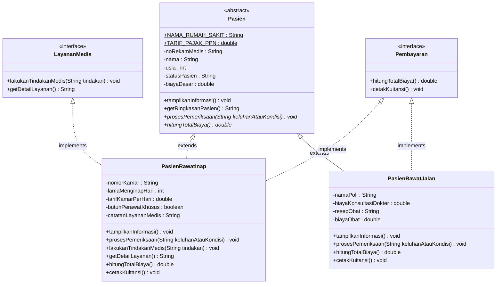

# Sistem Manajemen Pelayanan Pasien Rumah Sakit
**Tugas Responsi Akhir Praktikum Pemrograman Berorientasi Objek (PBO)**  
**Jurusan Informatika - Fakultas Teknik - Universitas Jenderal Soedirman**

---

## 1. Identitas Praktikan & Tema Penugasan

| Data | Keterangan |
| :--- | :--- |
| **Nama Lengkap** | [Isi Nama Lengkap Anda] |
| **NIM** | [Isi NIM Lengkap Anda - Akhiran 7] |
| **Digit Terakhir NIM** | **7** |
| **Tema Sistem** | **Rumah Sakit** (Sesuai Ketentuan NIM Akhiran 6 dan 7) |
| **Mata Kuliah** | Praktikum Pemrograman Berorientasi Objek |
| **Tahun Ajaran** | Semester Ganjil 2026/2027 |

---

## 2. Deskripsi Domain & Arsitektur Sistem

Sistem ini dirancang untuk memodelkan proses administrasi, pemeriksaan medis, evaluasi kondisi, dan pembayaran pasien pada instansi kesehatan (**Rumah Sakit**).

Struktur class mengadopsi prinsip Object-Oriented Programming (OOP) tingkat lanjut yang kohesif:
- **`Pasien` (Abstract Superclass)**: Menyimpan atribut umum identitas pasien, konstanta institusi, serta mendefinisikan kontrak abstract method untuk pemeriksaan dan perhitungan biaya.
- **`PasienRawatInap` (Subclass)**: Merepresentasikan pasien rawat inap (opname). Memiliki atribut kamar, durasi rawat, kebutuhan perawat khusus, serta mengimplementasikan dua interface (`LayananMedis` dan `Pembayaran`).
- **`PasienRawatJalan` (Subclass)**: Merepresentasikan pasien poliklinik rawat jalan. Memiliki atribut poli tujuan, biaya konsultasi dokter, resep obat, dan biaya farmasi, serta mengimplementasikan interface `Pembayaran`.
- **`LayananMedis` (Interface 1)**: Kontrak untuk tindakan medis langsung ke pasien.
- **`Pembayaran` (Interface 2)**: Kontrak untuk kalkulasi tagihan dan pencetakan kuitansi.
- **`Main` (Driver Class)**: Menjalankan skenario pengujian komprehensif untuk memverifikasi kesepuluh persyaratan teknis.



---

## 3. Pemetaan 10 Persyaratan Teknis Kode

Berikut adalah bukti kesesuaian kode terhadap seluruh persyaratan teknis dalam lembar penugasan:

| No | Konsep Teknis | Bukti Implementasi pada Kode | Lokasi File |
| :---: | :--- | :--- | :--- |
| **1** | **State dan Behavior** | Memiliki atribut variabel (`nama`, `statusPasien`, dll), method prosedur `void` (`cetakKuitansi()`, `tampilkanInformasi()`), dan method fungsi dengan `return value` (`hitungTotalBiaya()`, `getRingkasanPasien()`). | `Pasien.java`, `PasienRawatInap.java`, `PasienRawatJalan.java` |
| **2** | **Immutability** | Konstanta global: `public static final String NAMA_RUMAH_SAKIT` & `public static final double TARIF_PAJAK_PPN`.<br>Atribut instans kekal: `private final String noRekamMedis;` (tidak ada setter, nilai kekal seumur hidup objek). | `Pasien.java` (Baris 19-27) |
| **3** | **Enkapsulasi dan Overloading** | Seluruh atribut bersifat `private` dan diakses melalui getter/setter.<br>Menggunakan keyword `this` pada setiap inisialisasi dan manipulasi variabel instans.<br>Setiap class memiliki minimal 2 variasi konstruktor (*overloaded constructor*). | `Pasien.java`, `PasienRawatInap.java`, `PasienRawatJalan.java` |
| **4** | **Inheritance** | Superclass `Pasien` diturunkan ke dua subclass melalui `extends`: `PasienRawatInap` dan `PasienRawatJalan`.<br>Class `Main` berada di file terpisah (`Main.java`). | Seluruh berkas `.java` |
| **5** | **Super Chaining** | Pemanggilan `super(...)` pada konstruktor subclass untuk inisialisasi superclass.<br>Pemanggilan `super.tampilkanInformasi()` di dalam method subclass. | `PasienRawatInap.java` (Baris 30, 42, 54), `PasienRawatJalan.java` (Baris 28, 40, 52) |
| **6** | **Method Overriding** | Penimpaan method superclass pada subclass menggunakan anotasi `@Override` (`tampilkanInformasi()`, `prosesPemeriksaan()`, `hitungTotalBiaya()`). | `PasienRawatInap.java`, `PasienRawatJalan.java` |
| **7** | **Abstract Class** | Class `Pasien` dideklarasikan `abstract` dan memiliki abstract method: `public abstract void prosesPemeriksaan(String keluhanAtauKondisi);` dan `public abstract double hitungTotalBiaya();`. | `Pasien.java` (Baris 14, 76, 82) |
| **8** | **Logika State Percabangan** | Implementasi abstract method `prosesPemeriksaan()` membaca state internal objek (`getStatusPasien()`), mengevaluasi percabangan `if/else`, lalu mengubah state internal (`setStatusPasien()`, `setButuhPerawatKhusus()`, dll). | `PasienRawatInap.java` (Baris 67-101), `PasienRawatJalan.java` (Baris 65-98) |
| **9** | **Polimorfisme Interface** | Pemanggilan method melalui variabel referensi interface:<br>`LayananMedis layananMedis = new PasienRawatInap(...);`<br>`layananMedis.lakukanTindakanMedis(...);`<br>`Pembayaran refPembayaran = new PasienRawatJalan(...);` | `Main.java` (Baris 120-136) |
| **10** | **Multiple Interface** | Subclass `PasienRawatInap` mengimplementasikan minimal dua interface sekaligus:<br>`public class PasienRawatInap extends Pasien implements LayananMedis, Pembayaran` | `PasienRawatInap.java` (Baris 14) |

---

## 4. Petunjuk Compile dan Run melalui Terminal

Pastikan terminal berada pada direktori kerja repositori ini (`RESPONSI`).

### A. Windows (Command Prompt / PowerShell)
1. **Compile seluruh source code:**
   ```powershell
   javac *.java
   ```
2. **Jalankan program utama:**
   ```powershell
   java Main
   ```

### B. Linux / macOS (Bash / Zsh)
1. **Compile:**
   ```bash
   javac *.java
   ```
2. **Jalankan:**
   ```bash
   java Main
   ```

---

## 5. Salinan Luaran Program Terminal (Screenshot Replacement)

Berikut adalah luaran resmi yang dihasilkan saat program `Main` dijalankan:

```text
================================================================================
       PENGUJIAN SISTEM MANAJEMEN RUMAH SAKIT - RESPONSI AKHIR PBO             
================================================================================
Tema Sistem       : Rumah Sakit (Digit Terakhir NIM: 7)
Nama Rumah Sakit  : RSUD Margono Sehat Soedirman
================================================================================

>>> [BUKTI PERSYARATAN 2: Immutability]
1. Konstanta Global (public static final):
   - Pasien.NAMA_RUMAH_SAKIT = "RSUD Margono Sehat Soedirman"
   - Pasien.TARIF_PAJAK_PPN   = 11.0%
2. Atribut Instans Kekal (private final):
   - noRekamMedis diinisialisasi melalui konstruktor dan tidak dapat diubah (hanya getter).

>>> [BUKTI PERSYARATAN 3: Enkapsulasi dan Overloading Constructor]
Menginstansiasi objek PasienRawatInap dengan Konstruktor Variasi 1 (Ringkas):
-> Pasien 1 dibuat: [RM-2026-001] Budi Santoso (45 thn) - Status: Pendaftaran Baru

Menginstansiasi objek PasienRawatInap dengan Konstruktor Variasi 2 (Lengkap):
-> Pasien 2 dibuat: [RM-2026-002] Siti Aminah (60 thn) - Status: Rujukan Puskesmas

Uji Setter & Getter (Enkapsulasi) pada Pasien 1:
Nama sebelum diubah: Budi Santoso
Nama setelah setter: Budi Santoso, S.Kom.

>>> [BUKTI PERSYARATAN 4: Inheritance]
Menginstansiasi subclass kedua: PasienRawatJalan (extends Pasien)
Objek PasienRawatInap  adalah instance of Pasien: true
Objek PasienRawatJalan adalah instance of Pasien: true

>>> [BUKTI PERSYARATAN 5 & 6: Super Chaining & Method Overriding (@Override)]
Memanggil tampilkanInformasi() pada PasienRawatInap (memanggil super.tampilkanInformasi()):
==================================================
Instansi            : RSUD Margono Sehat Soedirman
No. Rekam Medis     : RM-2026-001 (Immutable)
Nama Pasien         : Budi Santoso, S.Kom.
Usia Pasien         : 45 tahun
Status Pasien       : Pendaftaran Baru
Biaya Pendaftaran   : Rp 50,000.00
Tipe Pasien         : Rawat Inap
Nomor Kamar         : Anggrek-01
Lama Menginap       : 3 hari
Tarif Kamar/Hari    : Rp 400,000.00
Perawat Khusus      : Tidak (Reguler)
Catatan Medis       : Pemasangan infus awal dan rawat inap umum.
--------------------------------------------------
Memanggil tampilkanInformasi() pada PasienRawatJalan (memanggil super.tampilkanInformasi()):
==================================================
Instansi            : RSUD Margono Sehat Soedirman
No. Rekam Medis     : RM-2026-003 (Immutable)
Nama Pasien         : Ahmad Fauzi
Usia Pasien         : 28 tahun
Status Pasien       : Pendaftaran Baru
Biaya Pendaftaran   : Rp 50,000.00
Tipe Pasien         : Rawat Jalan / Poliklinik
Poli Spesialis      : Poli Jantung
Biaya Konsultasi    : Rp 100,000.00
Resep Terapi        : Belum Diperiksa
Biaya Obat/Farmasi  : Rp 0.00
--------------------------------------------------

>>> [BUKTI PERSYARATAN 7 & 8: Abstract Method & Logika State Percabangan]
Mengeksekusi prosesPemeriksaan("Kritis") pada Pasien Rawat Inap:
State awal: Status=Pendaftaran Baru, ButuhPerawatKhusus=false

[Proses Visite Dokter & Evaluasi Kondisi]
Kondisi Pasien Masuk: Kritis
Status internal awal: Pendaftaran Baru
-> PERUBAHAN STATE: Status beralih ke ICU! Pendampingan perawat khusus diaktifkan.
State akhir: Status=Perawatan Intensif (ICU), ButuhPerawatKhusus=true

Mengeksekusi prosesPemeriksaan("Perlu Obat") pada Pasien Rawat Jalan:
State awal: Status=Pendaftaran Baru, Resep=Belum Diperiksa

[Proses Konsultasi Poli: Poli Jantung]
Keluhan Pasien      : Perlu Obat
Status internal awal: Pendaftaran Baru
-> PERUBAHAN STATE: Resep obat racikan dikeluarkan, pasien menuju loket farmasi.
State akhir: Status=Menunggu Obat di Farmasi, Resep=Antibiotik Spektrum Luas + Anti-inflamasi + Vitamin C

>>> [BUKTI PERSYARATAN 1: State dan Behavior]
1. Pemanggilan Method Fungsi (Return Value):
   - Return hitungTotalBiaya() Pasien Inap : Rp 4,218,000.00
   - Return hitungTotalBiaya() Pasien Jalan: Rp 316,350.00

2. Pemanggilan Method Prosedur (void):
================== KUITANSI RAWAT INAP ==================
Instansi            : RSUD Margono Sehat Soedirman
No. Rekam Medis     : RM-2026-001
Nama Pasien         : Budi Santoso, S.Kom.
Kamar / Durasi      : Anggrek-01 (3 hari)
Biaya Pendaftaran   : Rp 1,550,000.00
Biaya Kamar         : Rp 1,200,000.00
Biaya Perawat Khusus: Rp 1,050,000.00
PPN (11%)           : Rp 418,000.00
---------------------------------------------------------
TOTAL DIBAYARKAN    : Rp 4,218,000.00
Status Pembayaran   : LUNAS
=========================================================

================== KUITANSI RAWAT JALAN =================
Instansi            : RSUD Margono Sehat Soedirman
No. Rekam Medis     : RM-2026-003
Nama Pasien         : Ahmad Fauzi
Poli Layanan        : Poli Jantung
Biaya Pendaftaran   : Rp 50,000.00
Biaya Konsultasi    : Rp 100,000.00
Biaya Obat/Farmasi  : Rp 135,000.00
PPN (11%)           : Rp 31,350.00
---------------------------------------------------------
TOTAL DIBAYARKAN    : Rp 316,350.00
Status Pembayaran   : LUNAS
=========================================================

>>> [BUKTI PERSYARATAN 9: Polimorfisme Interface]
Variabel referensi bertipe Interface LayananMedis:
[LayananMedis] Tindakan diberikan kepada Dewi Lestari: Injeksi Vitamin & Fisioterapi Pasca Operasi
Hasil getDetailLayanan() via interface: Layanan Rawat Inap Kamar Melati-05 (Injeksi Vitamin & Fisioterapi Pasca Operasi)

Variabel referensi bertipe Interface Pembayaran:
Total Biaya dihitung via referensi Pembayaran: Rp 166,500.00

>>> [BUKTI PERSYARATAN 10: Multiple Interface]
Subclass 'PasienRawatInap' mengimplementasikan 'LayananMedis' dan 'Pembayaran':
-> pasienInap1 instanceof LayananMedis : true
-> pasienInap1 instanceof Pembayaran   : true

Demonstrasi pemanggilan kedua interface pada objek yang sama:
[LayananMedis] Tindakan diberikan kepada Budi Santoso, S.Kom.: Pemberian Terapi Nebulizer dan Bronkodilator
Detail Layanan: Layanan Rawat Inap Kamar Anggrek-01 (Pemberian Terapi Nebulizer dan Bronkodilator)
Total Tagihan : Rp 4,218,000.00

================================================================================
           SELURUH 10 PERSYARATAN TEKNIS BERHASIL DIVERIFIKASI!                 
================================================================================
```

---

## 6. Panduan Defense / Tanya Jawab Praktikum (Bobot 70%)

Gunakan ringkasan ini sebagai referensi saat sesi wawancara / tanya jawab dengan dosen atau asisten praktikum:

1. **Apa perbedaan antara konstanta global dan atribut instans kekal pada kode Anda?**
   - **Konstanta global** (`public static final`): Bersifat *class-level* (milik class, bukan objek), dapat diakses langsung via nama class tanpa instansiasi (`Pasien.NAMA_RUMAH_SAKIT`), dan nilainya bernilai konstan global untuk seluruh sistem.
   - **Atribut instans kekal** (`private final`): Bersifat *object-level* (`noRekamMedis`). Setiap objek pasien memiliki nomor rekam medis unik masing-masing yang ditentukan saat pembuatan objek lewat konstruktor, dan nilainya dikunci secara kekal (tidak memiliki setter).

2. **Mengapa class `Pasien` dijadikan `abstract`?**
   - Karena di dunia nyata tidak ada entitas "pasien generik" yang langsung ditangani tanpa spesifikasi rawat inap atau rawat jalan. Dengan `abstract`, class `Pasien` tidak dapat diinstansiasi secara langsung (`new Pasien()` akan menghasilkan error kompilasi), melainkan berfungsi sebagai template atau kontrak dasar bagi subclass konkret.

3. **Bagaimana super chaining bekerja?**
   - Pada konstruktor subclass (`PasienRawatInap`), pemanggilan `super(...)` meneruskan data umum (seperti no rekam medis, nama, dan usia) ke konstruktor `Pasien`.
   - Pada method `tampilkanInformasi()`, pemanggilan `super.tampilkanInformasi()` mencetak data dasar pasien terlebih dahulu sebelum mencetak atribut spesifik subclass rawat inap, sehingga menghindari duplikasi kode (*clean code* / DRY principle).

4. **Jelaskan konsep Polimorfisme Interface dan Multiple Interface pada sistem ini!**
   - **Multiple Interface**: Bahasa Java tidak mendukung *multiple inheritance* class (`extends` hanya boleh satu class), namun Java mendukung *multiple interface* melalui `implements LayananMedis, Pembayaran`.
   - **Polimorfisme Interface**: Variabel referensi bertipe interface dapat menunjuk ke instance class mana pun yang mengimplementasikan interface tersebut. Contoh:
     ```java
     LayananMedis lm = new PasienRawatInap(...);
     lm.lakukanTindakanMedis("Injeksi");
     ```
     Di sini, compiler hanya membatasi akses pada method yang didefinisikan dalam interface `LayananMedis`, meskipun objek aslinya adalah `PasienRawatInap`.

5. **Di mana logika state percabangan diimplementasikan?**
   - Terletak pada method `prosesPemeriksaan(String keluhanAtauKondisi)` di subclass. Method ini membaca nilai state objek saat ini (`getStatusPasien()`), mengevaluasi parameter via `if-else if-else`, kemudian mengubah state internal (`setStatusPasien()`, penyesuaian biaya, dan kebutuhan fasilitas perawat).
